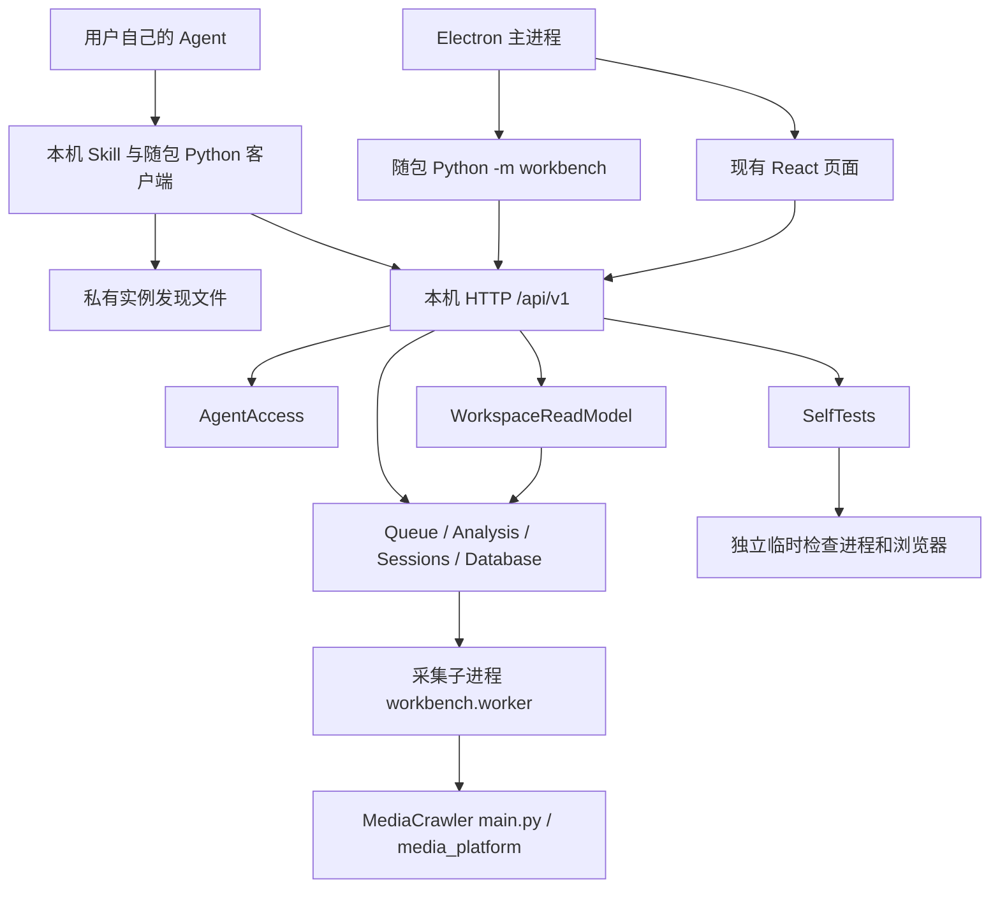

# 架构与维护入口

本文件描述当前源码的职责，配合 [0.5.0 规格](specs/0.5.0-state-recovery.md)、[开发约定](../CONTRIBUTING.md)、[术语](../GLOSSARY.md) 和 [就绪与诊断 ADR](adr/0001-readiness-and-diagnostics.md) 使用。0.5.0 使用 SQLite schema 5，保留 Electron、Python 和冻结的采集依赖。下方 0.4.x 说明保留历史背景；新增状态与恢复见末节。

## 入口与调用关系

| Module 或入口 | 实际文件 | 职责与 seam |
| --- | --- | --- |
| 桌面启动、托盘、单实例、更新 | `electron/src/entry.ts`、`main.ts`、`host.ts`、`guard.ts`、`updates.ts`、`preload.ts` | 管理本机后台和受限更新桥；页面 Node 权限及渲染沙盒规则沿用 |
| 后台启动与实例发现 | `workbench/__main__.py`、`paths.py` | 锁定数据目录、绑定回环端口、原子发布实例文件；退出只清理自身登记 |
| HTTP 组合入口 | `workbench/app.py:make_app` | 鉴权、请求模型与路由适配；组合下面三个 module 及原有业务 module |
| AgentAccess | `workbench/agent_access.py` | 生成同源短卡、受保护握手、兼容 capabilities；不执行采集、模型推理或完整诊断 |
| 外部 Agent 客户端 | `skills/media-workbench/scripts/workbench.py` | 定位当前实例、授权、兼容、有限恢复、请求回执、文件上传下载；PS1 留作兼容 adapter |
| WorkspaceReadModel | `workbench/workspace.py` | 统一任务、平台、数据集、分析覆盖率和成果的只读投影；沿用原有 HTTP 路径及返回结构 |
| 页面分区读取 | `webui/src/workbench/workspace-loader.ts`、`Workbench.tsx` | 仅读取当前页面所需分区；各区独立更新与报错，保留上次数据及正在编辑的输入 |
| SelfTests | `workbench/selftest.py`、`selftest_runner.py`、`process_scope.py` | 一个检查控制器，顺序执行独立本机及联网 phase worker；管理绝对时限、进程归属、取消、清理和重开恢复 |
| 既有业务 | `database.py`、`queue.py`、`worker.py`、`analysis.py`、`exports.py`、`sessions.py`、`session_store.py`、`auth.py` | 持久化、采集调度、分析输入快照与证据、成果文件、浏览器租约与账号状态 |

`AgentAccess`、`SelfTests`、`WorkspaceReadModel` 的 interface 集中承载接入、诊断、工作区读取三类变化。原有 Queue、Database、Analysis、PlatformSession 继续拥有各自事务及生命周期；没有将它们合成新的通用任务 DSL，也没有新增模型执行循环或跨产品公共库。

## 三个 interface 的兼容约定

**Agent 接入。** 首页仍请求 `format=connect`，布局保持。短卡优先指向安装提供的完整 Skill、原生 `python.exe`、现成客户端和确切实例路径；ZIP 是备选。实例文件含本机凭据，交给客户端读取，不复制其正文。`GET /api/v1/agent/handshake` 受现有本机鉴权保护，返回产品、版本、协议、实例、数据目录身份、能力修订及按需帮助，不返回账号和业务数据。`instance_id` 随后台启动改变，`workspace_id` 来自规范化数据根；能力修订排除运行时间与账号等动态值。

客户端 `connect` 返回紧凑就绪信息，`check` 保留历史能力字段。只有握手明确 404/405 才采用旧版健康、能力及受保护设置接口的兼容路径；401/403 不降级成公开检查。写请求保留 ID、原内容与回执；一次重新发现只允许同一数据目录，先查原回执再决定是否同 ID 重放。公开 health 有响应不等于授权成功。

**独立自检。** 连接确认和能力介绍只做轻量握手；明确的整套安装或运行排障才执行自检。七项检查仍包含真实临时浏览器、隔离后台与重开、合成队列/去重、从软件取得的 Skill、五格式导出及游客试采。含联网时总 180 秒分为本机 125、联网 45、清理 10；仅本机为 170+10。启动、退出计入所属阶段，不读取账号浏览器档案。本机阶段共享一个临时浏览器，各步骤关闭各自页面与 context。结果增加 `attempted`、`reason`、`phases`、`timings`，原接口和字段保留。

**工作区读取。** overview 读取 jobs/datasets/analyses/artifacts；jobs 读取 jobs/platforms；data 读取 datasets；analyses 读取 analyses/artifacts；platforms 读取 platforms；settings 自行读取 settings/diagnostics 及诊断状态。一次分区失败不使其他成功数据消失；失败区显示原因和重试入口，已有数据注明保留。编辑中的关键词、勾选和浏览器路径不会被轮询重置。

## 六个对象的生命周期

以下状态来自 `database.py`、`queue.py`、`analysis.py`、`session_store.py`，不是六套统一状态枚举。

| 对象 | 当前生命周期与实际状态 |
| --- | --- |
| Job（采集任务） | 创建为 `queued`，执行转 `running` 并增加 attempt；主动停止经 `stopping` 到 `cancelled`。执行结果可为 `completed`、`partial`、`failed`、`interrupted`、`needs_login`。除 `completed` 外，允许恢复的已停止任务可重新入队。同账号新认证可恢复因认证暂停的原任务，主动停止的任务不自动恢复。归档记录单独保存，不删除数据或账号 |
| Dataset（数据集） | 创建或导入后可追加记录、分页查询；无独立 `state` 列。记录以稳定来源键去重，原始修订另存；已创建 Analysis 的输入快照不随追加数据改变 |
| Analysis（分析） | 创建为 `waiting_agent`；Batch 保存进度后仍等待 Agent。finish 在无待处理/失败项时置 `completed`，允许交付不完整结果时置 `partial`。partial 可继续提交批次后回到 waiting_agent；completed 拒绝新批次，但相同已完成批次的重放仍返回原回执 |
| Batch（批次） | 无独立 `state` 列；一次事务确认结果、输入处理状态及批次回执。相同 analysis_id/batch_id 与相同内容返回原响应，不同内容冲突。输入覆盖状态为 `pending`、`processed`、`skipped`、`failed`；结果 evidence 必须属于该分析快照 |
| Artifact（成果） | 导出或附件保存为文件并登记 ID、关联分析、相对路径、MIME、SHA256 和大小；无独立 `state` 列。下载读取已登记文件，不能用文件存在推断研究质量或覆盖率 |
| PlatformSession（平台会话） | 浏览器与档案绑定、账号身份及 generation 持久保存。保存状态为 `not_saved`/`saved`/`failed`；最近检查另有 `not_checked`/`authenticated`/`logged_out`/`challenge`/`network_error`/`unknown`。保存成功不等于当前在线；网络问题不抹掉最近成功记录，明确登出及“忘记账号”才按现有规则失效 |

独立自检不创建 Job。其运行状态为 running/cancelling，结束可能 completed/cancelled/timed_out/interrupted/failed；completed 仅表示流程结束。判定本机看 local_state，联网看 network_state；未尝试步骤为 skipped、attempted=false，已开始超时的本机步骤为 interrupted 且本机结论 incomplete。清理未完成保留归属及恢复信息。

## 数据、凭据与更新

默认业务根为 `%LOCALAPPDATA%/MediaWorkbench/data`，发现文件为其父目录 `instance.json`；原 `MEDIAWORKBENCH_DATA_DIR` 和 `MEDIAWORKBENCH_INSTANCE` 可覆盖。浏览器档案、加密快照及成果保持现有目录；Electron 缓存位于数据根的 `electron-ui`。核心 Skill/客户端由安装维护，用户定制资料另存数据目录；本轮不引入 MediaSail 的可写 workspace 及全量三方合并机制。

发布版本只有 `pyproject.toml` 一个来源。构建经 Forge 生成 Electron 目录，Velopack 管理原产品身份 `MediaWorkbench.Desktop`、主程序 `MediaWorkbench.exe` 和 win-preview。0.4.0候选记录保留；用户本机试用后批准发布0.4.1预览，发布策略绑定具体版本。GitHub标签触发检查、打包、隔离升级和草稿附件核验，成功后发布；真实外部Agent验收仍如实标为待验证。

0.4.1首页文件复制通过受限preload只传文件名，主进程从AgentAccess同源Markdown接口读取内容，写入当前数据目录的独立分享文件，再调用Electron文件剪贴板。分享文件不随退出删除；普通浏览器使用原文字路径，完整Skill与附件入口分开维护。见[规格](specs/0.4.1-skill-file.md)。

## MediaCrawler 固定基线与继承补丁清单

[upstream.lock.json](../upstream.lock.json) 固定 [MediaCrawler 380b426000aac3d612837ed72c99808347dc94c9](https://github.com/NanmiCoder/MediaCrawler/tree/380b426000aac3d612837ed72c99808347dc94c9)。`workbench/upstream.py` 从该文件读取运行时 revision。本轮冻结采集/浏览器依赖，**没有声称重新合并上游最新代码**。

本清单以该上游到本轮起始已提交源码的 `git diff --name-status` 为证据：下面共 39 个继承定制文件，多数汇入历史提交 `b693f78`。新增的 `workbench/`、`electron/`、Skill 和桌面构建属于产品层，另见上面的入口图。

| 继承范围 | 文件清单与现有作用 |
| --- | --- |
| 七个平台适配（21） | `media_platform/{bilibili,douyin,kuaishou,tieba,weibo,xhs,zhihu}/{client.py,core.py,login.py}`：保留各平台客户端/采集/登录定制，接入 `managed_login`、结构化登录进度、受管理浏览器及既有资料补采路径；不表示七个平台全部经过本轮真实验证 |
| 小红书异常（1） | `media_platform/xhs/exception.py`：既有专用异常分类 |
| 旧 API 兼容（6） | `api/main.py`、`api/routers/{crawler.py,data.py}`、`api/schemas/{__init__.py,crawler.py}`、`api/services/crawler_manager.py`：旧网页/配置及恢复逻辑保留。Electron 主后台使用 `python -m workbench`，不是以旧 crawler_manager 取代新持久队列 |
| 配置与参数（2） | `cmd_arg/arg.py`、`config/base_config.py`：既有采集选项及运行配置。`workbench/worker.py` 将持久 Job 映射到原 `main.py`，强制本产品关闭媒体下载 |
| 写入与旧潜客输出（2） | `tools/async_file_writer.py`、新增 `tools/lead_sink.py`：产品模式先提交 SQLite，再独立记录 JSONL 写入结果；保留旧补采/潜客路径。历史路径中的业务规则不作为通用 Analysis 或 Skill 的约束 |
| 浏览器及登录工具（3） | `tools/browser_launcher.py`、`tools/cdp_browser.py`、`tools/crawler_util.py`：既有浏览器定位、连接受管理会话、档案根及二维码/登录反馈接点 |
| 存储、代理及依赖（4） | `store/kuaishou/__init__.py`、`proxy/base_proxy.py`、`pyproject.toml`、`uv.lock`：现有兼容与锁定依赖差异；本轮除项目版本元数据外不据此升级采集运行时 |

复核命令：`git diff --name-status 380b426000aac3d612837ed72c99808347dc94c9 HEAD -- api cmd_arg config media_platform proxy store tools pyproject.toml uv.lock`。继承差异不是本轮新增补丁数；后续确实更新上游时须重新审计，并保留各自 LICENSE/NOTICE，不能把整个项目统一改为 MIT。

0.4.2首页只调用MD文件复制桥，保留改名；移除前端文字回退和手动复制弹窗。旧HTTP文字/ZIP接口仅为兼容保留；普通浏览器与旧桌面显示简短升级提示，不获取接入文本。

0.4.3删除首页文件名编辑及展开控件，接入区仅保留任务台和复制Skill。首页使用固定默认文件名，文件复制桥的兼容接口及安全校验保持不变。

## 0.4.4 采集结束记录

`tools/crawl_status.py`在现有任务运行目录保存按运行次数隔离的JSONL结束记录；平台只提交阶段、范围、原因和白名单响应结构信息。队列按本次运行读取并将汇总追加到checkpoint.collection，继续保留退出码、已保存数量和旧worker日志适配。HTTP与Skill共享该结果，不增加数据库表。正常接口结束、设置数量及无结果与异常未确认分开；不能据此证明全站覆盖或账号不受限制。

本轮定制新增抖音异常类型的安全原因/HTTP状态字段，以及搜索、评论、回复的终止报告；不重新合并上游或升级采集依赖。浏览器与登录租约不变，历史任务记录保留。旧版缺少结构化结束证据时不追认真实平台原因。

## 0.5.0 状态与恢复

`recovery.py` 统一投影 HTTP、页面及 Skill 的状态解释，保存轮次、范围、结构化事件与计数；`ownership.py` 是业务写入和账号代次的共同围栏。队列按事务登记预期范围，再派发采集；平台请求的 `observed` 接点补充动态范围及白名单响应信息。列表本身不作为终页证据，缺失证据保守记未确认。

`availability.py` 保存每项能力、独立操作、等待和冷却决策；`probe_runner.py` 管理受控子进程及 60 秒总预算，`probe_worker.py` 只读对照，`request_budget.py` 约束各层网络请求。探测与 Job 共享队列和浏览器租约，但不创建研究数据。自动探测和冷却只对抖音启用，其他平台仍使用原有采集及认证续接。`raw_files.py` 从数据库修订重建派生文件，文件状态独立于业务提交。

本轮继承补丁：七个 `client.py` 增加显式按能力的观测接点；抖音请求支持共享预算、429 与 Retry-After 原因；`tools/crawl_status.py` 同步有围栏的范围事实；`tools/async_file_writer.py` 改为数据库先提交。无关上游代码保持原样，原作者 NON-COMMERCIAL LEARNING LICENSE 1.1 及各文件来源声明继续保留。未合并新的上游提交，也未升级第三方锁文件或浏览器。

新增 API：`jobs/ID/{explain,attempts,scopes,diagnostics,raw-files}`、`operations/ID`、`platforms/ID/{probes,availability}`，均受本机认证保护。操作返回旧 job 字段并追加 operation_id；实际状态须继续查询，HTTP 200 只代表受理。任务台保留 MD 文件入口，新增轮次时间线及脱敏诊断；客户端增加 explain/probe/operation。

## 0.5.1 验收修复

`sessions.py` 的档案检查使用 `contextlib.closing` 确定释放只读 Cookie 数据库连接后才启动浏览器，避免 Chromium 无法加载已保存凭据。没有修改继承的 MediaCrawler 客户端或浏览器参数。`electron/src/host.ts` 在一个启动预算内等待旧子进程并最多替换一次，以生命周期代次撤销停止前的启动及迟到发现；`main.ts` 在后台缺失时继续监测，主动更新停止时暂停监测。依赖、上游提交和 schema 5 维持冻结。
